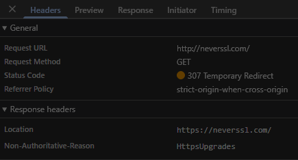
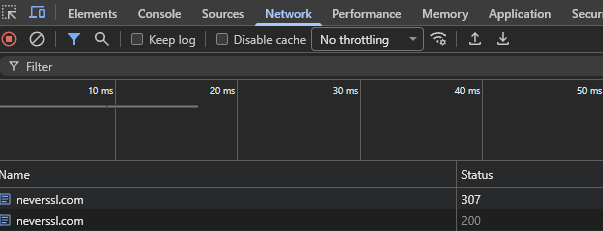
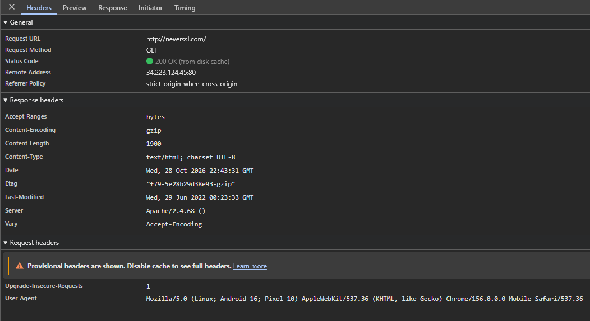

# 🔐 Práctica Wi-Fi Segura — Informe de Auditoría de Red Wi-Fi Insegura


## 1. Introducción

Las redes Wi-Fi públicas (bares, aeropuertos, terminales, shoppings) son cómodas, pero en general **no garantizan la confidencialidad del tráfico**: cualquier persona conectada a la misma red, o quien controle el punto de acceso, puede llegar a observar lo que viaja entre nuestro dispositivo y internet.

El objetivo de este informe es demostrar, con evidencia real tomada desde las herramientas de desarrollador del navegador, **qué información queda expuesta cuando se navega por HTTP** (sin cifrado), comparar esa situación con HTTPS, y explicar cómo una **VPN** reduce estos riesgos. Al final se proponen tres reglas prácticas para navegar de forma segura.

---

## 2. Sitio analizado

| Dato | Valor |
|------|-------|
| Sitio | `http://neverssl.com` |
| Propósito del sitio | Sitio creado a propósito para **no usar nunca SSL/TLS**. Se usa para forzar la aparición de portales cautivos y para pruebas como esta. |
| Herramienta usada | DevTools del navegador (F12) → pestaña **Network / Red** |
| Procedimiento | Abrir el sitio → F12 → pestaña Network → recargar (F5) → seleccionar la primera solicitud (tipo `document`) |

> **Nota:** neverssl.com suele redirigir a un subdominio aleatorio (por ejemplo `http://wonderousfinewholespell.neverssl.com/online/`) para evitar que el navegador use una versión en caché. Ese comportamiento es normal y no cambia el análisis: todo sigue viajando por HTTP.

---

## 3. Evidencia observada

### Primer hallazgo: el navegador intentó proteger la conexión

Al ingresar `http://neverssl.com` con la configuración por defecto del navegador, la **primera solicitud** registrada en la pestaña Network fue:

| Campo | Valor observado |
|-------|-----------------|
| **Request URL** | `http://neverssl.com/` |
| **Request method** | `GET` |
| **Status code** | `307 Temporary Redirect` |
| **Referrer policy** | `strict-origin-when-cross-origin` |

Esta respuesta **no la envió el servidor**. La generó el propio navegador con su función de *mejora automática a HTTPS* ("Usar siempre conexiones seguras" / HTTPS-Upgrades): detectó una URL `http://` y antes de enviarla por la red la redirigió internamente a `https://neverssl.com/`. Por eso la página terminó cargando por HTTPS.

**Conclusión:** los navegadores modernos ya mitigan parte del riesgo, pero esa protección:
- depende de una **configuración que el usuario puede desactivar** (o que en navegadores viejos no existe);
- **vuelve a HTTP** si el sitio no soporta HTTPS (*fallback*);
- **no protege** el tráfico de otras apps del celular o la PC, que no pasan por el navegador.

Para observar el tráfico inseguro real se desactivó temporalmente la opción "Usar siempre conexiones seguras" y se repitió la prueba. Los resultados se ven a continuación.




### Datos generales de la solicitud (con la mejora a HTTPS desactivada)

| Campo | Valor observado |
|-------|-----------------|
| **URL solicitada** | `http://neverssl.com/` |
| **Método HTTP** | `GET` |
| **Host** | `neverssl.com` |
| **Protocolo** | `HTTP/1.1` (sin TLS — el esquema es `http://`, no `https://`) |
| **Código de estado** | `200 OK` |
| **Indicador del navegador** | Candado ausente / leyenda **"No seguro"** junto a la URL |

### Headers de la solicitud (Request Headers)

```http
GET / HTTP/1.1
Host: neverssl.com
User-Agent: Mozilla/5.0 (Linux; Android 16; Pixel 10) AppleWebKit/537.36 (KHTML, like Gecko) Chrome/156.0.0.0 Mobile Safari/537.36
Accept: text/html,application/xhtml+xml,application/xml;q=0.9,image/avif,image/webp,*/*;q=0.8
Accept-Encoding: gzip, deflate, br, zstd
Accept-Language: es-ES,es;q=0.9
Connection: Keep-Alive
Upgrade-Insecure-Requests: 1
```

### 3.3 Headers de la respuesta (Response Headers)

```http
HTTP/1.1 200 OK
Content-Type: text/html; charset=UTF-8
Content-Encoding: gzip
Server: Apache
Connection: Upgrade, keep-alive
```

### 3.4 Capturas





---

## 4. Análisis

### ¿Qué protocolo utiliza el sitio?

El sitio utiliza **HTTP** (HyperText Transfer Protocol), **no HTTPS**. Se comprueba por:

- La URL comienza con `http://`.
- En DevTools la columna *Protocol* muestra `http/1.1` y no hay pestaña ni detalle de certificado.
- El navegador marca el sitio como **"No seguro"**.

**Diferencia clave:**

| | HTTP | HTTPS |
|---|------|-------|
| Cifrado | ❌ Ninguno — viaja en texto plano | ✅ Cifrado con TLS |
| Puerto por defecto | 80 | 443 |
| Autenticación del servidor | ❌ No hay forma de verificar que el sitio sea el real | ✅ Certificado digital emitido por una autoridad confiable |
| Integridad | ❌ El contenido puede modificarse en el camino | ✅ Cualquier alteración se detecta |
| Qué ve un intermediario | **Todo**: URL completa, headers, cookies, formularios, contenido | Solo el dominio (vía DNS/SNI), IPs y volumen de datos |

### ¿Qué información puede observarse durante la solicitud?

Al no haber cifrado, todo lo que se ve en DevTools es exactamente lo que vería un atacante en la red. Elementos visibles:

1. **Host** (`neverssl.com`) → revela a qué sitio se conecta la víctima.
2. **URL completa y ruta** (`/`, `/online/`, o rutas con parámetros como `?usuario=...&busqueda=...`) → revela qué página exacta se visita y qué datos van en la URL.
3. **Método HTTP** (`GET`) → indica el tipo de acción; si fuera `POST`, el **cuerpo del formulario** (usuario, contraseña, datos personales) también sería legible.
4. **User-Agent** → revela sistema operativo, navegador y versión (útil para buscar vulnerabilidades específicas del equipo).
5. **Accept-Language** (`es-AR`) → da pistas del idioma y la región del usuario.
6. **Cookies** (si el sitio las enviara) → permiten **robar la sesión** sin necesidad de la contraseña.
7. **Contenido de la respuesta** → el HTML completo que recibe el usuario.

### ¿Qué riesgos existen al navegar mediante HTTP desde una Wi-Fi pública?

| Riesgo | Descripción | Qué se puede perder |
|--------|-------------|---------------------|
| **Sniffing (escucha pasiva)** | Un atacante en la misma red captura paquetes con herramientas como Wireshark y lee todo el tráfico HTTP en texto plano. | Historial de navegación, búsquedas, datos de formularios. |
| **Robo de credenciales** | Si se envía un login por HTTP, usuario y contraseña viajan legibles en el cuerpo del `POST`. | Cuentas de correo, redes sociales, sistemas de trabajo. |
| **Secuestro de sesión (Session Hijacking)** | El atacante copia la cookie de sesión y la usa en su navegador para entrar como la víctima. | Acceso total a la cuenta sin conocer la contraseña. |
| **Man-in-the-Middle (MitM)** | El atacante se interpone entre víctima y router (por ej. con ARP spoofing) y puede **modificar** las respuestas. | Inyección de malware, publicidad, scripts maliciosos o redirecciones a sitios falsos. |
| **Evil Twin (punto de acceso falso)** | Se crea una red con un nombre creíble ("Wifi_Aeropuerto_Free") y todo el tráfico pasa por el equipo del atacante. | Todo lo anterior, de forma más fácil. |
| **Phishing / portales cautivos falsos** | Páginas de "inicio de sesión a la Wi-Fi" que piden datos personales o credenciales. | Email, contraseñas, datos de tarjeta. |
| **Perfilado del usuario** | Con User-Agent, idioma, sitios visitados y horarios se arma un perfil de la persona. | Privacidad; base para ataques dirigidos. |

**Conclusión del hallazgo:** en una Wi-Fi pública, navegar por HTTP equivale a **enviar una postal en lugar de una carta cerrada**: cualquiera en el camino puede leerla y hasta cambiar lo que dice.

### ¿Cómo cambiaría este escenario utilizando una VPN?

Una **VPN (Virtual Private Network)** crea una conexión cifrada entre el dispositivo y un servidor VPN. Todo el tráfico sale primero hacia ese servidor y recién desde ahí va a internet.

```
SIN VPN:
[Mi PC] --(HTTP texto plano)--> [Wi-Fi pública / atacante 👀] --> [Internet] --> [neverssl.com]

CON VPN:
[Mi PC] ==(túnel cifrado 🔒)==> [Wi-Fi pública / atacante ❓] ==> [Servidor VPN] --> [Internet] --> [neverssl.com]
```

- **Cifrado:** antes de salir del equipo, todos los paquetes se cifran con algoritmos robustos (por ejemplo AES-256 o ChaCha20, usando protocolos como WireGuard u OpenVPN). Aunque alguien capture el tráfico, solo ve datos ilegibles.
- **Túnel seguro:** la VPN encapsula cada paquete dentro de otro paquete cifrado dirigido al servidor VPN. Para la red Wi-Fi solo existe **una única conexión hacia el servidor VPN**; no se ve el Host, la URL, el método, los headers ni el User-Agent.
- **Protección del tráfico:** como los paquetes están cifrados y autenticados, el atacante en la Wi-Fi **no puede leerlos ni modificarlos** → se neutralizan el sniffing, el robo de cookies y los ataques MitM *en el tramo de la red local*. También protege las consultas DNS si la VPN las gestiona.
- **Privacidad:** el sitio de destino ve la **IP del servidor VPN**, no la del usuario, y el dueño de la Wi-Fi o el proveedor de internet no puede saber qué sitios se visitan.

**Limitaciones importantes (lo que la VPN NO hace):**

- Entre el servidor VPN y `neverssl.com` el tráfico **sigue siendo HTTP sin cifrar**. La VPN protege el tramo de la Wi-Fi, no reemplaza a HTTPS.
- Se traslada la confianza al **proveedor de VPN**: él sí podría ver el tráfico HTTP. Conviene usar proveedores confiables y no VPN gratuitas dudosas.
- No protege contra phishing, malware ni contraseñas débiles.

> La combinación ideal es **HTTPS + VPN**: HTTPS protege de extremo a extremo con el sitio, y la VPN protege la privacidad en la red local.

---

## 5. Riesgos encontrados (resumen)

| # | Hallazgo | Severidad | Recomendación |
|---|----------|-----------|---------------|
| 1 | El sitio se sirve solo por HTTP, sin cifrado. | 🔴 Alta | Usar únicamente sitios HTTPS; en servidores propios, configurar TLS y redirigir HTTP → HTTPS (HSTS). |
| 2 | URL, Host, método y headers visibles en texto plano. | 🟠 Media | Usar VPN en redes públicas. |
| 3 | User-Agent e idioma permiten identificar el equipo y perfilar al usuario. | 🟡 Baja | Mantener navegador y SO actualizados; usar VPN. |
| 4 | Cualquier formulario o cookie enviada por HTTP sería interceptable. | 🔴 Alta | Nunca ingresar credenciales en sitios HTTP. |
| 5 | El contenido podría ser modificado en tránsito (MitM). | 🔴 Alta | HTTPS + VPN; activar modo "Solo HTTPS" del navegador. |
| 6 | La protección del navegador (redirección 307 a HTTPS) se puede desactivar y no cubre a las apps fuera del navegador. | 🟠 Media | Mantenerla siempre activa y no depender solo de ella: usar VPN. |

---

## 6. 🏆 Mis 3 Reglas de Oro para navegar en Wi-Fi públicas

### 1️⃣ Si no hay candado, no hay datos
Nunca ingresar contraseñas, datos bancarios ni información personal en un sitio que no use **HTTPS**. Activar el modo **"Solo HTTPS"** del navegador para que avise o bloquee los sitios HTTP.

### 2️⃣ VPN encendida antes de navegar
Conectar la **VPN apenas me uno a la red**, antes de abrir cualquier app o página. Así todo el tráfico viaja por un túnel cifrado y nadie en la red puede leerlo ni modificarlo.

### 3️⃣ Desconfiar de la red y de mi propio equipo
Verificar con el personal del lugar el **nombre exacto de la red** (evitar "Evil Twins"), desactivar la conexión automática a redes abiertas y el uso compartido de archivos, activar la **verificación en dos pasos (2FA)** en mis cuentas y cerrar sesión / "olvidar la red" al terminar.

---

## 7. Conclusión

La práctica demostró que con solo abrir las herramientas de desarrollador se puede ver toda la información de una solicitud HTTP. En una Wi-Fi pública, un atacante puede ver exactamente lo mismo — y modificarlo. **HTTPS** cifra la comunicación con el sitio y una **VPN** cifra todo el tráfico en la red local; juntos, más buenos hábitos, reducen drásticamente el riesgo.

---

